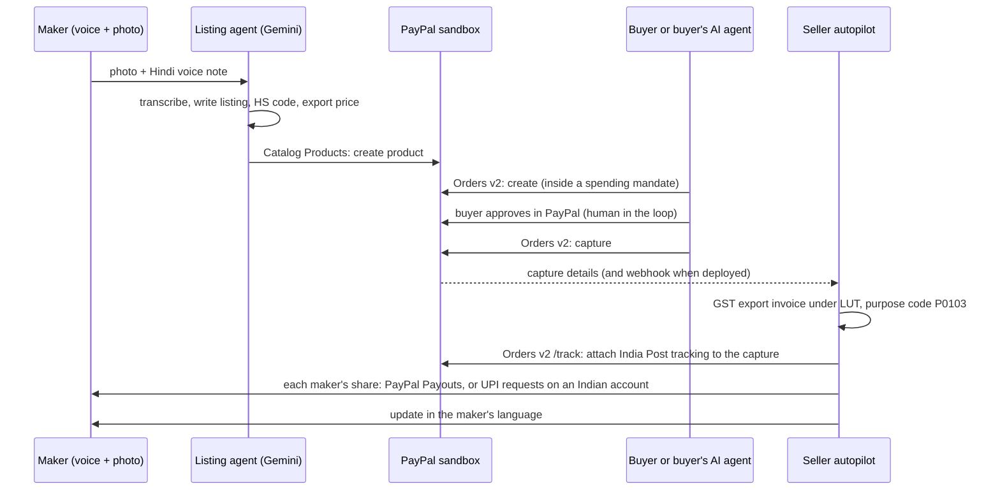

# Haat

**An export desk run by AI agents, settled by PayPal.** A maker in India sends a photo and a voice note in Hindi or Tamil. Haat writes the listing, prices it for export, sells it to buyers abroad and to their AI shopping agents, and after PayPal settles the payment it does the export paperwork, adds tracking to the capture, and pays every maker in the cooperative their share.

Built for the PayPal AI Hackathon 2026. Everything runs against the **PayPal sandbox** with real API calls.

| | |
|---|---|
| Landing page | `/` |
| The whole loop on one screen | `/app/live` |
| Seller studio (voice + photo to listing) | `/app/seller/bagru-chhipa-prints` |
| Buyer shopping agent | `/app/agent` |
| Shop with PayPal checkout | `/app/shop` |
| Ledger of every PayPal call, dispute desk, MCP | `/app/ledger` |
| MCP endpoint for outside agents | `POST /mcp` |

## The problem

India's handloom weavers, block printers and potters make things buyers abroad want. What stops a sale is everything around it: an English listing, an export price that survives fees and currency conversion, a trusted way to get paid, a GST export invoice under a Letter of Undertaking, the RBI purpose code on the inward remittance, tracking for seller protection, and splitting the money with the people who wove it. PayPal is how small Indian sellers get paid from abroad, and since 2021 that cross-border flow is PayPal's whole business in India. Haat is the desk that does the rest, in the maker's own language.

Buyers are also starting to shop through AI agents. Those agents can only buy from catalogues that are machine-readable and payable. Haat makes a weaver with no website agent-ready.

## The loop



## How PayPal is used

Every call below is a real sandbox request. Each one appears on the Ledger page with its status, latency and `PayPal-Debug-Id`.

| Capability | API | Where | Why it matters |
|---|---|---|---|
| OAuth 2.0 client credentials, token cache | `/v1/oauth2/token` | `server/src/paypal/client.ts` | single-flight refresh, 401 retry |
| Checkout | Orders v2 create + capture, JS SDK Smart Buttons | `server/src/paypal/api.ts`, `web/src/ui.tsx` | idempotent (`PayPal-Request-Id`), item breakdown, `payer-action` link for agents, `ORDER_ALREADY_CAPTURED` handled |
| Catalogue | Catalog Products v1 | `server/src/domain/commerce.ts` | every live listing is mirrored into the PayPal Catalog |
| Seller protection | Orders v2 `/track` | `server/src/agents/autopilot.ts` | tracking attached to the capture, buyer notified |
| Paying the makers | Payouts v1, or a UPI split | `server/src/agents/autopilot.ts` | `PAYOUT_MODE=paypal`: one Payouts batch per order from a marketplace account outside India. `PAYOUT_MODE=upi`: PayPal accounts registered in India cannot send payouts, so each share becomes a UPI request the cooperative sends in one tap (our sandbox setup) |
| Wholesale | Invoicing v2 via the **PayPal Agent Toolkit** (`create_invoice`, `send_invoice`, `send_invoice_reminder`, `list_invoices`) | `server/src/agents/seller.ts`, `server/src/paypal/toolkit.ts` | the seller says "send an invoice to the shop in Berlin" in Hindi |
| Reporting | Agent Toolkit `list_transactions`, `get_merchant_insights` | `server/src/paypal/toolkit.ts` | the seller can ask what came in |
| Disputes | Disputes v1 list/get (toolkit and REST), `provide-evidence` (multipart), `accept-claim` | `server/src/agents/disputes.ts` | evidence drafted from the tracking Haat already attached |
| Webhooks | register, `verify-webhook-signature` | `server/src/index.ts` | `CHECKOUT.ORDER.APPROVED` captures server-side if a tab closed |
| Agentic commerce | MCP server (Streamable HTTP) over Orders v2 | `server/src/mcp/server.ts` | outside agents (Claude, ChatGPT, custom) can search and start a PayPal checkout that a human approves |

The official [`@paypal/agent-toolkit`](https://github.com/paypal/agent-toolkit) tools are converted from their Zod schemas into Gemini function declarations (`server/src/paypal/toolkit.ts`), so the seller agent calls PayPal's own tool implementations. Toolkit calls are recorded on the ledger as `KIT` rows.

## How AI is used

All models are Google Gemini through `@google/genai` (`server/src/ai/gemini.ts`), with automatic fallback across models when one is overloaded.

- **Listing agent** (`agents/listing.ts`): one multimodal call reads the photo and the voice note together, transcribes the original language, translates, writes an honest listing, proposes an HS code with a reason, and extracts the asking price and stock. Structured output via JSON schema. The prompt forbids claims the maker did not make.
- **Export pricing** (`domain/pricing.ts`): deterministic. It works backwards from the maker's rupees through PayPal's fee, GST on the fee and the conversion spread, using a live mid-market rate.
- **Seller agent** (`agents/seller.ts`): a tool-using agent that talks in the maker's language and acts through PayPal (Agent Toolkit tools plus Haat tools). Voice notes are transcribed first.
- **Buyer agent** (`agents/buyer.ts`): a tool-using shopping agent bound by a spending mandate. It can create a PayPal order but cannot pay; the human approves in PayPal.
- **Autopilot** (`agents/autopilot.ts`): after capture, a compliance step chooses the RBI purpose code and GST treatment and checks the HS code; then it runs tracking and the makers' split (Payouts or UPI), and writes the maker an update in their language.
- **Dispute desk** (`agents/disputes.ts`): reads real disputes and recommends sending evidence or refunding, based on the evidence Haat actually holds.

## Run it

Requirements: Node 22.13+ (Node 24 recommended), a free PayPal developer account, a Gemini API key.

```bash
npm install
```

```bash
cp .env.example .env
```

Fill in `.env`:

- `PAYPAL_CLIENT_ID`, `PAYPAL_CLIENT_SECRET`: developer.paypal.com > Apps & Credentials > **Sandbox** > Create App. In the app's features, enable Invoicing, Payouts and Transaction search.
- `PAYOUT_MODE`: `upi` if the sandbox business account is registered in India (ours is), `paypal` for a marketplace account outside India, `auto` to learn from the first refusal. Indian PayPal accounts receive international payments into an Indian bank but cannot send PayPal Payouts, so Haat splits the money by UPI instead: PayPal brings the dollars in, UPI carries the rupees the last mile.
- Approving test payments needs a sandbox **Personal account outside India** (an Indian merchant cannot take a domestic Indian payment).
- `GEMINI_API_KEY`: aistudio.google.com/apikey.

```bash
npm run build
```

```bash
npm start
```

Open http://localhost:8787. The sample makers and catalogue load on first boot and are mirrored into your PayPal sandbox catalogue.

For frontend work: `npm run dev` (API on 8787) and `npm run dev:web` (Vite on 5173, proxied).

## Try it in two minutes

1. Open the app at `/app/live` (or the deployed URL plus `/app/live`).
2. Press **Send Rafiq's voice note**. You don't need a microphone: it sends a sample photo and a 25-second Hindi voice note (download them: [photo](server/seed/images/studio-raw-photo.jpg), [voice note](server/seed/images/sample-voice-hi.wav)). Every Hindi message shows its English underneath.
3. Tap **Publish** on the phone, then press **Ask the buyer's agent**.
4. Approve the payment in the PayPal popup with the sandbox buyer below.
5. Watch the stopwatch stop and the "Where the money went" sheet rise.

## Testing it (judges)

1. Open `/app/live` and press **Send Rafiq's voice note** (top right). The stopwatch starts.
2. The phone shows each stage, his words come back transcribed first, then the listing assembles. In about 20 to 30 seconds the listing appears with the price, the rupees the maker receives, and the HS code. Tap **Publish**. A `POST /v1/catalogs/products` appears on the ledger on the right.
3. Press **Ask the buyer's agent**, or type to it: "A handmade gift for my mother, she likes indigo. Under $60 delivered." It searches, recommends, and prepares a PayPal order. An approval card appears.
4. Approve with the PayPal sandbox **buyer** account below. The capture lands on the ledger, and the order's autopilot runs: export invoice, tracking on the capture, each maker's share (UPI requests on our Indian sandbox account, PayPal Payouts on a marketplace account), and a Hindi message (text and voice note) on the maker's phone. The stopwatch stops and a sheet shows where every dollar went, down to each maker by name.
5. Open the order to see the printable GST export invoice.
6. In the seller chat, try: "बर्लिन की दुकान anna@example.com को 20 दुपट्टे का इनवॉइस भेज दो, 15 डॉलर एक का". The agent confirms, then sends a PayPal invoice with the Agent Toolkit.

Sandbox buyer for approving payments (a US sandbox Personal account, test money only):

- Email: `sb-llyqp53881641@personal.example.com`
- Password: `K/r0fBv?`

### Connect an outside agent over MCP

```json
{ "mcpServers": { "haat": { "type": "http", "url": "https://<your-deployment>/mcp" } } }
```

Tools: `search_catalog`, `product_details`, `request_checkout` (returns the PayPal approval link), `order_status`. After approval, PayPal returns the human to `/checkout/return`, which captures and starts the autopilot.

### Reset the demo

`POST /api/demo/reset` (set `DEMO_RESET_TOKEN` on a hosted deployment and send `{ "token": "..." }`).

## Deploy

`render.yaml` is a Render blueprint: one Node web service that builds the React app and serves the API, the app and the landing page. Set `PUBLIC_URL` to the service's https URL; on first boot Haat registers a PayPal webhook and prints its id, which you then set as `PAYPAL_WEBHOOK_ID` so signatures are verified.

## What is real and what is simulated

- Real: every PayPal call (sandbox), every AI call, the pricing maths, the documents generated.
- Simulated: the India Post booking (tracking numbers follow the EMS format and are attached to the real PayPal capture, but no parcel is booked); WhatsApp transport (the seller chat is a web chat built to look like the phone the maker already uses); maker payout emails are sample addresses, so sandbox Payouts land as unclaimed; maker UPI IDs use a demo handle (`@haatdemo`) that no UPI app routes to, so the UPI buttons open a UPI app but cannot move real money.
- Estimates: PayPal's fee (4.4% + $0.30), GST on fees and the ~3.5% conversion spread are configurable and labelled as estimates in the UI. Check the [PayPal India fee page](https://www.paypal.com/in/webapps/mpp/merchant-fees).
- Sample data: Meera Devi, Rafiq Chhipa and Kalaiselvi Murugan are illustrative profiles, not real businesses. GSTIN, IEC and LUT numbers are format-valid placeholders. Product photos are stock photography (see `server/seed/images/CREDITS.md`).
- The export invoice is a working draft for the seller to check, not tax advice.

## Stack

Node 24 + Express 5 + TypeScript (run with `tsx`), SQLite via `node:sqlite`, React 19 + Vite + Tailwind CSS 4, Server-Sent Events for live updates, `@google/genai`, `@paypal/agent-toolkit`, `@modelcontextprotocol/sdk`.

## License

MIT, see `LICENSE`.
